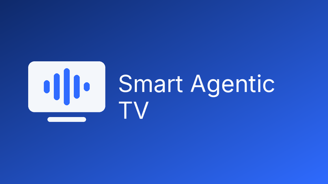
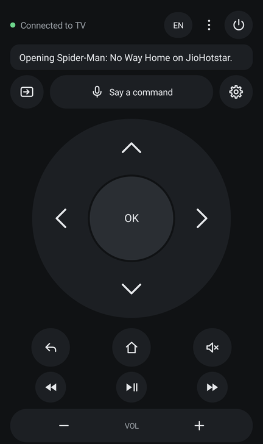
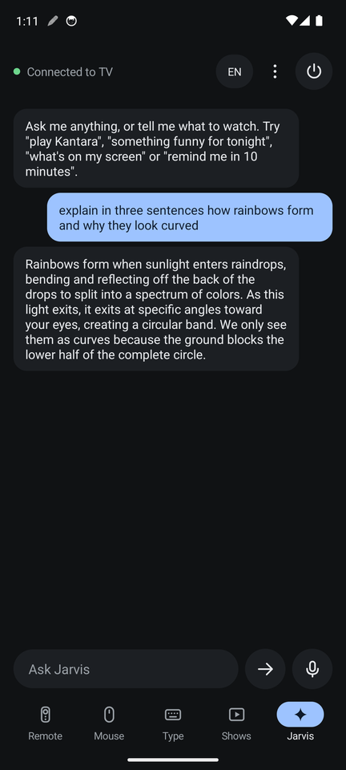
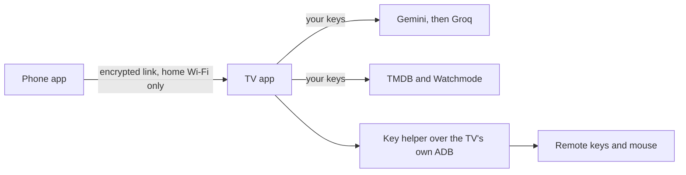

<div align="center">



# Smart Agentic TV

**Turn a cheap Android TV board into a clean TV you can talk to.**

A new home screen, a phone remote, and a voice assistant called Jarvis. It's for the Chinese and universal Android boards found in retrofitted and budget TVs. Free, open source and MIT licensed, and it runs on your own free API keys.

[Install](docs/INSTALL.md) · [Supported boards](docs/SUPPORTED-BOARDS.md) · [Add your board](docs/ADD-YOUR-BOARD.md) · [API keys](docs/API-KEYS.md) · [Jarvis](docs/JARVIS.md) · [Privacy](docs/PRIVACY.md)

</div>

> **Early project: tested on one board so far.** That board is a U.11 universal board (HiSilicon Hi3751V350, Android 9). Other Android TV boards may need a small [board profile](docs/ADD-YOUR-BOARD.md). If you try yours, please [report how it went](../../issues/new?template=board-report.yml).

<p align="center">
  
  &nbsp;&nbsp;
  
</p>

## What you get

**On the TV**
- A fast home screen with no ads, and a shelf with your apps
- Trending picks from the apps you have, and a glass volume bar
- A way back: the TV's own launcher is left in place

**On your phone**
- A remote with a round pad, volume, media keys, a touchpad mouse and typing
- Search that forgives wrong words: "Kantara Karana movie" still finds Kantara
- Each result shows which app has it, and one tap opens it on the TV
- Voice commands in English, Hindi and Kannada

**Jarvis, the assistant**
- "Play Kantara", "in Zee5 open Ayyana Mane", "something funny for tonight"
- "What's on my screen?", "remind me in 10 minutes", "turn off the TV in 30 minutes"
- "When I say movie night, set the volume to 30 and open YouTube"
- Answers normal questions and remembers the conversation
- Asks before anything hard to undo, like turning the TV off

## How it works



The keys live on the TV, not on phones. The AI can only propose actions from a fixed list, and the TV checks each one. See [Jarvis](docs/JARVIS.md).

## Quick start

You need a computer with `adb`, and a TV with ADB turned on. The [install guide](docs/INSTALL.md) has every step.

1. Download `SmartAgenticTV.apk` and `MyTV.apk` from [Releases](../../releases).
2. Run `adb connect <TV IP>:5555`, then `adb install -r SmartAgenticTV.apk`.
3. Set it as the home screen and open **Settings > Phone** on the TV.
4. Install `MyTV.apk` on your phone and pair it with the code on the TV.
5. In the phone app, open the menu, choose **API keys** and paste your [free keys](docs/API-KEYS.md).

Other phones on your Wi-Fi can then get the app from a link the TV shows, with no computer needed.

## What each app allows

Apps decide what they accept from outside, so this varies. Results from the tested TV, in India:

| App | Opening a title |
|---|---|
| Zee5 | Starts the title |
| JioHotstar | Opens the title's page |
| YouTube | Shows search results |
| Sun NXT | Searches inside the app using remote keys |
| PlayBox | Opens the app only |
| Netflix | Not usable on the tested board |

## What this is not

- **Not a way around DRM or app rules.** It doesn't fake a device or patch apps. If an app refuses your board, a certified device on HDMI is the real fix.
- **Not risk free.** It needs ADB, and on many of these boards ADB has no password. Read [Security](SECURITY.md) first.
- **Not a promise for every board.** Don't open factory menus to make it work: they can damage a board.

## Build it yourself

```bash
./build.sh          # builds the phone app, then the TV app that carries it
tools/check.sh      # tests, builds and a scan for keys
```

You need JDK 17 and the Android SDK (build-tools 34, platform 34). There's no Gradle and there are no libraries.

## Contributing

Reports from new boards help the most. See [CONTRIBUTING](CONTRIBUTING.md), and [how to add your board](docs/ADD-YOUR-BOARD.md).

## Credits

- Started from [Free My TV](https://github.com/simbasjungles/free-my-tv) by its contributors (MIT). The home screen and much of the TV app are their work.
- `tools/adb-closed.py` is from [cleanyourtv](https://github.com/Gathin23/cleanyourtv) by Gathin (MIT).
- Built with [Claude Code](https://claude.com/claude-code).
- Fonts, icons and services are listed in [third-party notices](THIRD-PARTY-NOTICES.md). This product uses the TMDB API but is not endorsed or certified by TMDB.

## License

[MIT](LICENSE). Use it, change it, ship it.
